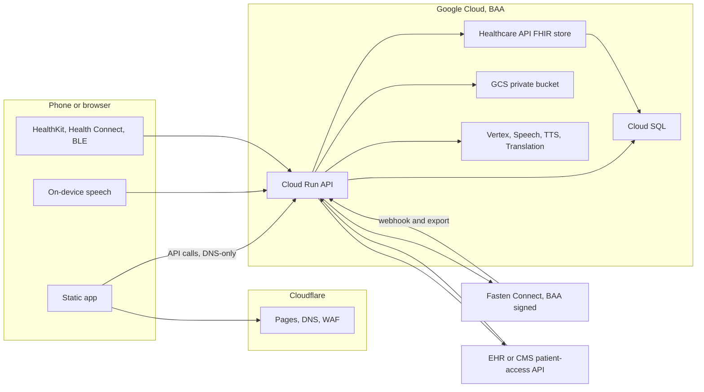

# Consolidation plan — one patient-owned PHR

**Date:** 24 October 2026
**Status:** Phase 1. This document and the scaffolding in the same change. Not a rewrite.
**Canonical repo:** `tabula-medica-phr` (this one). US and World are one codebase. `TABULA_REGION=world` turns TEFCA off.

Nothing in this change archives or deletes another repository.

## What was actually read

This repo was read in tree. The GitHub token for this run can see the public `Tabula-medica` repositories. It cannot see `tabula-medica-phr-world`, `tabula-phr-unified`, `tabula-phr-app`, `tabula-medica-web`, or a `worldehr` / `world-ehr` / `omnihealth-ehr` repository. Those names return not found. `tabula-medica-web` is already described as archived by the owner.

What this repo itself proves:

- `deploy-world.sh` deploys **this** image to a Cloud Run service named `tabula-medica-phr-world` with `TEFCA_ENABLED=false`. The international product is already a flag, not a second application.
- World patient features live here: `shared/jurisdictions.ts`, `server/services/world/` (International Patient Summary and the signed health passport), `server/world-ips-routes.ts`, and the ABDM consent notes in `docs/abdm-consent-dataflow.md` (sandbox, off until `ABDM_ENABLED=true`).
- The outpatient revenue-cycle blueprint is `docs/WORLD_EHR_OUTPATIENT_RCM_BLUEPRINT.md`, and the portable engine is `server/rcm/`. That document describes a clinic product (`omnihealth-ehr`) that this token could not open. Patient-facing slices are called out below. The billing engine stays a clinic tool.
- Fasten is a real ingestion path: `server/auth/fasten.ts`, `server/auth/fasten-import.ts`, `server/auth/fasten-export-parsing.ts`. The owner has a Fasten BAA in place.
- A Cloud Healthcare API FHIR store is already addressed at `projects/united-planet-485003-n7/locations/us-central1/datasets/tabula-medica-data/fhirStores/patient-records` (`server/utils/healthcareUtils.ts`).
- An in-memory dedup model already keeps provenance (`ProvenanceLink.rawData` in `shared/schema.ts`). `storage.ts` can delete a dedup **group**. That delete must not cascade into the FHIR store. `healthcareUtils.ts` also exposes a FHIR `delete` helper. The reconciliation pipeline does not call it.

Cells in the matrix that say "not visible" mean the source was not available to read. The decision still follows the owner's description of that repo.

## 1. Product vision and differentiators

Tabula Medica is the record the patient owns. A health system portal shows one organization's chart. A phone health app shows what that phone collected. This product keeps both, plus what the patient types, in one FHIR store they can take with them.

Three things are pillars, not settings buried in a menu.

**Any language.** The interface, the teaching text, and the assistant's answers use the patient's language. Clinical records are translated for reading, and the original text stays beside the translation. Right-to-left layout is part of the same work (Arabic, Farsi, Urdu, Hebrew, Pashto are already marked in `client/src/components/language-provider.tsx`). US and World ship from this repo. TEFCA and the US Fasten network are on only when `TABULA_REGION` is `us`.

**Voice first.** The owner builds voice products. A member can move through the app by voice, dictate a symptom, a medication, or a vital, and hear the record read aloud. That is how the product serves low literacy and older adults. Speech that can carry PHI uses Google Cloud Speech-to-Text and Text-to-Speech under the Google Cloud BAA, with data logging left off (the BAA note on Speech-to-Text says not to opt in to data logging), or it stays on the device. The browser Web Speech API and consumer transcription APIs are outside that boundary. `shared/voice/policy.ts` encodes the allow-list. Voice is a path alongside the screen. It is not the only path. A person who cannot speak, or who is Deaf, still uses the keyboard, the screen reader, and captions.

**Accessible by default.** Revised Section 508 for web, iOS, Android, documents, and voice. The legal web bar is WCAG 2.0 AA. The target is WCAG 2.2 AA. Large text and a low-bandwidth mode are part of the Medicaid and Medicare tier, because a cheap phone on a tight data plan is a normal way to open this app. Details and the audit checklist are in section 8.

### How this compares

|  | Apple Health | MyChart | CommonHealth | Fasten (the product) | This PHR |
| --- | --- | --- | --- | --- | --- |
| Whose record | The phone, tied to an Apple ID | One health system | The Android phone, pulled over SMART | A patient app plus a connect widget | The patient, in a GCP FHIR store they can export |
| Other health systems | Health Records where a system participates | That system's chart | SMART pulls on Android | Many US portals through one widget | Fasten, plus a direct SMART / Blue Button path into the same store |
| Devices | Strong, on device | Limited | Limited | Not the point of Connect | HealthKit, Health Connect, BLE, and Terra when that vendor's own agreement exists |
| Language and voice | System language, not a multilingual clinical record | The health system's portal languages | English-first | The widget's languages | A pillar: UI, answers, and read-aloud, original text kept |
| Accessibility | Apple's platform bar | Varies by health system | Open-source Android app | Their app | Section 508 / WCAG 2.2 AA is a release gate, including PDFs |
| Price | Free with the phone | Free with being a patient there | Free client | Their pricing | $1/month for Medicaid and Medicare, near the GCP cost (`docs/PRICING.md`) |
| Outside the US | A US-centric health record | One system's portal | US SMART | US network | Same app, region flag, IPS and a signed passport, national networks such as ABDM when registered |

Fasten is the middleware we use, under a BAA that is already signed. It is not the system of record. The system of record is the Cloud Healthcare API FHIR store.

## 2. Feature matrix

Decisions: **Keep** (already in this repo and it stays), **Port** (bring the patient-facing behavior up to the bar of the prototype or the clinic product), **Drop** (does not belong in the patient app).

| Feature | This repo | World / World EHR | unified, phr-app, Base44 | Decision |
| --- | --- | --- | --- | --- |
| Conditions, medications, allergies, immunizations, labs, vitals, documents, timeline | Pages and FHIR mappers, including Fasten import | Same image | Base44 prototypes of the same screens. unified and phr-app were not visible | **Keep.** One set of screens. Port any Base44 interaction that is clearer for a patient, and leave the Base44 SDK behind |
| Fasten Connect | `server/auth/fasten*.ts`, `/fasten-connect` | Off when TEFCA is off | Base44 listed "FHIR connect" | **Keep** as the primary US retrieval path |
| Direct SMART on FHIR (Epic, Oracle Health, athena, and any ONC-certified patient-access API) and CMS Blue Button 2.0 | Direct Blue Button and Epic-shaped clients exist beside Fasten. See section 3 | US only | — | **Keep** as the second path, the one with no middleman |
| Redox, Particle | Catalog and stub rows in `server/services/healthcare-data-aggregator-service.ts` and the lab stub that names Particle for LabCorp | — | — | **Drop** from the patient app. They are middlemen. A missing LabCorp portal is a Fasten catalog gap or a direct patient-access registration, not a reason to add Particle |
| TEFCA | Gated in `server/routes.ts` | Off on world | — | **Keep** in the US, behind the region flag. Use Fasten's TEFCA connection where Fasten offers it. Do not run a second QHIN stack |
| International Patient Summary, signed health passport, jurisdiction registry | `server/services/world/`, `shared/jurisdictions.ts` | This is the world product | — | **Keep** in both regions. The passport is how a record travels |
| ABDM / ABHA consent | `docs/abdm-consent-dataflow.md`, off by default | The India exchange | — | **Port** to production only after ABDM registration and a data-protection agreement. Sandbox stays sandbox |
| Caregivers | `client/src/pages/caregivers.tsx` and related hubs | Useful everywhere | Base44 caregivers | **Keep.** One caregiver model, permissioned |
| Advance directives | `client/src/pages/advance-directives.tsx` | State forms are US; the document slot is global | Base44 | **Keep** |
| Emergency medical card | `client/src/pages/patient-features.tsx` (`/api/patient-features/emergency-card`) | Same need | Base44 | **Keep.** Make it a first-class screen, large type, readable offline |
| Care gaps | `client/src/pages/care-gaps.tsx` | Patient view only | Base44 | **Keep** the patient view. Medicare gap rules stay US-only |
| Care packets | `client/src/pages/care-packets.tsx` | Same | Base44 | **Keep**, and make the PDF tagged (section 8) |
| Drug savings | `client/src/pages/drug-savings.tsx` | US drug prices | Base44 | **Keep** in the US. Hide prices that are not meaningful in the world region |
| Symptom checker | `client/src/pages/symptom-checker.tsx`, public | Same | Base44 | **Keep.** Voice entry lands here |
| Women's health | `client/src/pages/womens-health.tsx` | Same | Base44 | **Keep** |
| Mental health | PHQ-9 / GAD-7 in `client/src/pages/intake-history.tsx` and `patient-reported-outcomes.tsx` | Same | Base44 | **Keep** the screeners. Show a crisis path in the patient's language. This is not a treatment service |
| ASCVD | `client/src/pages/ascvd-calculator.tsx` | US pooled-cohort equations are the wrong model for some populations (`docs/world-ehr-next-gen-plan.md`) | Base44 | **Keep**, and name the model on screen. Port a jurisdiction-aware calculator beside it. Never swap models silently |
| Assistants: lab explainer, insurance navigator, prior-auth guide, medication guide, clinical-trial matcher | Pieces exist (`lab-explanation.tsx`, `prior-auth-letter.tsx`, `ai-case-review-dashboard.tsx` links out to ClinicalTrials.gov) | Prior-auth rules in `server/rcm/` are a clinic tool | Base44 listed them as separate bots | **Port** into one assistant that speaks the patient's language. Trial matching shares nothing with a sponsor unless the patient agrees to that share |
| Auth | GCIP / Firebase (`client/src/lib/gcip.ts`) plus Fasten as proof of a portal connection, not as the only login | Same | Base44 auth | **Keep** GCIP. Fasten links a chart to the person. It does not replace the login |
| Subscription | `client/src/pages/subscription-paywall.tsx` | — | Base44 subscription | **Keep** the household plan. Add the $1 tier in `docs/PRICING.md` |
| Device data | Terra client and wearable services; several "connectors" are not a production BLE or HealthKit stack | Same | — | **Port** onto the interface in `shared/devices/`. Section 5 |
| Patient cost estimate, Good Faith Estimate, sliding-fee explanation, a statement the patient was given, prior-auth status the patient can see | Partial (insurance learning, prior-auth letter, uninsured tools) | `server/rcm/` has the clinic versions of estimate, GFE, sliding fee, statements, and prior auth | — | **Port** the patient-facing slice only |
| Clinic RCM: charge capture, claim scrubbing, 837P, ERA posting, denial work queues, payer calls, collections, propensity to pay, contract modeling | `server/rcm/` and `docs/WORLD_EHR_OUTPATIENT_RCM_BLUEPRINT.md` | This is the outpatient division's product | — | **Drop** from the patient app. Leave the clinic repo alone if a clinic still runs it |
| Provider RVU, HCC coding for billing | US routes gated on TEFCA | Clinic tools | — | **Drop** from the patient app |
| Second web frontend (`tabula-phr-unified`) | Not visible. Described as React + shadcn for a Cloud Run backend. This repo is already React + shadcn + Express | — | — | **Drop** as a codebase. Port a screen only if a person using it can name something this repo lacks |
| Second mobile app (`tabula-phr-app`) | Not visible. Described as a small React Native app. This repo's mobile path is Capacitor (`capacitor.config.ts`, `android/`, `ios/`) | — | — | **Drop** as a codebase. Capacitor wraps this client |
| `tabula-medica-web` | Archived, per the owner | — | — | Already archived. Leave it archived |
| Base44 and Replit hosting | Import notes under `.local/`. No BAA | — | — | **Drop** from the production path. Ideas can be ported. The SDK and the host cannot |

## 3. Retrieval

Two paths, one store.

### Primary: Fasten Connect

The patient connects a portal, a payer, or a TEFCA source that Fasten lists, through the Stitch widget. The Fasten BAA is already signed, so Fasten may handle production PHI.

Today the webhook path is real and the system of record is not yet the FHIR store:

1. The static app (eventually Cloudflare Pages) loads the widget in the browser.
2. The patient signs in at their provider or payer.
3. Fasten posts `patient.ehi_export_success` to Cloud Run (`/api/fasten-connect/webhook`). The API hostname is DNS-only at Cloudflare, so the export does not sit in a Cloudflare cache or log body.
4. `server/auth/fasten-export-parsing.ts` checks the event and refuses a download URL that is not Fasten's.
5. `server/auth/fasten-import.ts` downloads the bundle and maps FHIR into application storage.

Target, and the order to build it:

1. Steps 1–4 stay.
2. Write every resource to the Cloud Healthcare API FHIR store named above, tagged `source=fasten`.
3. Put the raw export in a private GCS bucket (CMEK, lifecycle rule).
4. Run reconciliation (section 4).
5. Project the reconciled view into Cloud SQL for the screens.
6. Log the event type and ids. Do not log the bundle.

TEFCA stays inside this path, and only in the US region. A world deployment does not register Fasten webhooks.

### Second path: direct patient access

Patients have a right of access under HIPAA. The Cures Act, through the ONC certification rules, requires certified EHRs to offer a patient-access API, which in practice is SMART on FHIR with a standalone launch. CMS requires payer Patient Access APIs, including CMS Blue Button 2.0 for Medicare and the Medicaid and plan APIs that implement the same rule.

The app can therefore register its own SMART client and talk to Epic, Oracle Health (Cerner), athenahealth, other ONC-certified patient-access endpoints, and CMS Blue Button 2.0 with no middleman. Tokens are exchanged on Cloud Run. Resources land in the **same** FHIR store, tagged `source=direct-smart` or `source=cms-blue-button`.

Use the direct path when:

- the patient wants it,
- Fasten's catalog does not list that organization or plan yet,
- or a single connection is cheaper than a Fasten connection for the $1 tier.

### Trade-off

|  | Fasten | Direct SMART / Blue Button |
| --- | --- | --- |
| Agreements | One BAA, already signed | Our own app registration at each vendor (open.epic, Oracle code console, athena marketplace, CMS Blue Button). Each vendor's developer terms. No second BAA when the covered entity's own API sends data straight to us |
| What we maintain | Widget, webhook, export parser | Redirect URIs, client ids, PKCE, refresh, US Core version drift, and outages, per endpoint |
| Coverage | Whatever Fasten has connected this month | Whatever we have registered. A long tail of small hospitals waits until we register or until Fasten lists them |
| Cost | Contracted platform fee, shared across members | Engineering time. No per-connection middleware fee |
| PHI leaves us for a vendor | Yes, to Fasten, under the BAA | The EHR or CMS already holds it. Our copy goes straight to GCP |
| Failure | One vendor, one status page | Many endpoints, each with its own status |

Both paths are kept. Building a custom portal scraper, or a private Redox or Particle feed, is not a third path.

### Coverage gaps to track in the open

- A health system or Medicaid plan that is in neither Fasten's catalog nor our direct registrations.
- TEFCA Individual Access where Fasten does not yet offer that QHIN. Wait for Fasten, or use that organization's own patient-access API. Do not build a QHIN client in this app.
- Write-back into a hospital chart (scheduling into Epic, sending a message as the clinic). EHI export and patient-access reads are the scope. Messaging the clinic is a separate feature.
- International exchanges. Fasten and TEFCA are US. ABDM and other national networks are the world-region equivalent, each with its own registration.
- LabCorp-via-Particle was a stub. If Fasten or a direct LabCorp patient endpoint does not exist, that lab is a gap, not a Particle integration.
- Device data, patient-typed data, and uploads. They are not retrieval. They join at the FHIR store.

## 4. Reconciliation

Every inbound resource is stored in the Cloud Healthcare API FHIR store first. Fasten exports, direct SMART pulls, Blue Button claims, device Observations, uploads, and what the patient types are all rows in that store. Cloud SQL holds the view the screens query.

The pipeline, in this order:

1. **Deterministic match.** Same patient compartment. Same resource type. Same identifier system and value, or the same canonical code plus the same calendar day plus the same value in one UCUM unit. A repeated webhook for the same source id is one member, not two. `shared/fhir/reconcile.ts` is this step, with no network and no delete.
2. **Terminology.** Map to RxNorm (medications), LOINC (labs and vitals), or SNOMED CT (conditions) when the mapping is known. An unknown local code stays unknown. It is not guessed.
3. **Semantic match, only for what step 1 could not decide.** Vertex AI under the Google Cloud BAA: Healthcare Natural Language API and embeddings. Data logging off. The model returns a score. `applySemanticDecision` merges the view when the caller accepts the score. The two source resources stay in the group.
4. **Conflicts stay visible.** Same LOINC, same day, different value is a conflict (`value_mismatch` already exists on the dedup types in `shared/schema.ts`). Both values remain. The screen shows the disagreement.

Provenance is the point. Each member remembers source, source system, and source resource id. The reconciled screen is a view. Merging does not delete, overwrite, or replace the source resource in the FHIR store.

A patient's later request to delete their record is a different workflow: export, then an audited removal of that patient's compartment. The matcher never does that as a side effect of a merge. `storage.ts` may drop an in-memory dedup group today. Wire the new pipeline so that call cannot reach `fhir.delete`.

### Apigee

Apigee is an API gateway. It does not deduplicate FHIR. It is already on the Google Cloud BAA list, so it is available if a partner contract demands a managed gateway or if a public API we publish needs quotas Apigee is better at. It is optional.

The default, and the one that keeps the vendor list short: Cloud Run serves the API in front of the FHIR store, Google Cloud API Gateway or Cloud Armor covers rate limits on that API, and Cloudflare covers only the static site, DNS, and the site WAF. PHI requests go to Cloud Run on a DNS-only record.

## 5. Devices

Device data is a separate ingestion path into the same FHIR store. It is not Fasten and not SMART.

| Integration | How it runs | Agreement |
| --- | --- | --- |
| Apple HealthKit | Capacitor plugin, on the iPhone | None for the read. Apple is not our business associate for an on-device read. The copy in GCP is ours, under the Google BAA |
| Android Health Connect | Capacitor plugin, on the phone | Same as HealthKit. Many Fitbit, Samsung, scale, and cuff apps already write here |
| Bluetooth LE | GATT Blood Pressure `0x1810`, Glucose `0x1808`, Weight `0x181D`, Heart Rate `0x180D`, Pulse Oximeter `0x1822`, Continuous Glucose `0x181F` | None. Pairing stays on the phone. Omron cuffs, glucometers, and scales that speak these services use this path |
| Terra | Already integrated for read-only fitness data (`server/services/terra-integration-service.ts`) | Terra's own BAA before any production PHI. The Fasten BAA does not cover Terra |
| Dexcom cloud, Omron cloud, and similar | Vendor APIs | That vendor's agreement. Prefer HealthKit, Health Connect, or BLE when the same reading is already on the phone |

The $1 tier ships the on-device paths. Terra and vendor clouds wait on their agreements and their prices (`docs/PRICING.md`).

### Consent

The operating-system permission dialog is not informed consent. Before the first read, the app records a consent receipt: which integration, which data types, when, and the notice version. The receipt does not contain the readings. Revoking it stops future pulls, calls Terra's deauthenticate when Terra was the source, and leaves already-stored Observations in the FHIR store until the patient asks for those to be removed. `shared/devices/consent.ts` is the predicate the future sync job should call.

Each Observation is tagged `source=device` and carries a stable identifier so reconciliation can see the same reading arrive twice (`shared/devices/observation.ts`). Device data is device-generated. It is not marked provider-attested. The health passport's assurance levels already depend on that honesty.

### Flow

Phone or webhook → Cloud Run (TLS) → FHIR Observation in the Healthcare API store → deterministic reconcile → Cloud SQL projection for the vitals screen. The existing Terra mapper splits clinical vitals from wellness metrics (`mapTerraPayloadToReadings`). Keep that split. A workout average heart rate is not a resting heart rate, and it must not page someone.

## 6. Architecture and where PHI lives

PHI is written and read on Cloud Run, Cloud SQL, the FHIR store, and GCS. Vertex, Speech, TTS, and Cloud Translation see PHI only as processors under the same BAA, with training and speech data logging off. Identity Platform stores the login, not the chart, and not PHI in a display name or custom attribute (the BAA note on Identity Platform is specific about this).

Cloudflare serves the static shell, DNS, and a WAF on that shell. The API record is DNS-only, so request bodies are not cached and not stored there. No Worker KV, R2, or D1 for health data. `Cache-Control: no-store` is set on `/api/public-config` and belongs on every API response.

Fasten is the one non-Google processor on the retrieval path, and the BAA is signed. A device vendor who receives readings on their servers is another processor and needs their own agreement before production.

Base44, Replit, the consumer OpenAI API, the consumer Gemini API, and browser Web Speech are not on this diagram.

Secrets live in Secret Manager. GitHub Actions refers to them by name (`deploy-backend-cloudrun.yml`). They are not in the repo.

## 7. Region flag

`shared/deployment-region.ts` is the switch.

- `TABULA_REGION=us` (the default when the variable is unset): TEFCA follows `TEFCA_ENABLED`, which stays on unless set to `false`. Existing US deploys do not change.
- `TABULA_REGION=world`: TEFCA is off even if `TEFCA_ENABLED=true`.
- `GET /api/public-config` returns `{ region, tefcaEnabled }` and `no-store`. The client reads it in `client/src/hooks/use-tefca.ts`. `VITE_TABULA_REGION` is only the build-time hint for a shell that is built twice.

World is not a fork. `deploy-world.sh` can set `TABULA_REGION=world` the next time that script is touched. This change does not rewrite it.

## 8. Section 508

Revised Section 508 (the 2017 refresh) incorporates WCAG 2.0 Level AA for web content. It also covers software (the iOS and Android shells), support documentation, and electronic documents. WCAG 2.2 AA is the target. Meeting 2.2 AA, and not shipping broken markup, covers the 2.0 AA criteria that 508 still points at. WCAG 2.2 removed success criterion 4.1.1 Parsing; 508's reference to 2.0 still includes it, so the client stays valid HTML.

Chapter 3 of the 508 standards is the functional performance bar: usable without vision, with limited vision, without color perception, without hearing, with limited hearing, without speech, with limited manipulation, and with limited language or cognitive ability. Voice-first and plain language serve the last of those. They do not replace a screen reader or a keyboard for people who cannot speak or hear.

The current self-evaluation is `docs/accessibility-conformance-report.md` (23 August 2026). Status: **Partially Supports**. It is a self-evaluation. It is not a VPAT a Medicare or Medicaid plan can drop into a procurement file. The known open items in that report still stand: live captions on telehealth, captions on the onboarding clip, contrast not measured, focus order not walked, screen readers not used, status messages not audited.

### Screen readers

Test VoiceOver (iOS and macOS), TalkBack (Android), NVDA, and JAWS on the journeys in the checklist. Every control has a name. Reading order matches the visual order. RTL languages set `lang` and `dir` (the language provider already sets both on `<html>`). Decorative images have an empty alt. Charts have a text alternative. Toasts and completed voice commands use a live region.

### Keyboard

Every action is reachable without a pointer. No keyboard trap in dialogs, the date picker, the Fasten widget, or the SMART launch popup. Visible focus. Skip link. Escape closes dialogs. The existing `clickable()` helper stays the pattern for anything that is not a native button.

### Contrast and text size

Body text at least 4.5:1, large text and UI boundaries at least 3:1, in both themes. `shared/a11y/preferences.ts` defines default, large (1.25), and extra-large (1.5) text. Low-bandwidth mode skips autoplay, large images, and prefetch. Information is not conveyed by color alone.

### Captions, transcripts, and voice

Prerecorded video ships with captions. Live telehealth needs captions before that feature is called conformant (gap 1 in the current report). Anything the assistant speaks is also on screen, so a Deaf member and a screen-reader user get the same words. A transcript is kept with the voice note. Auto-playing audio is off.

### PDFs and care packets

Current PDF output uses pdfkit (`server/snapshot-pdf-service.ts`, `server/tefca-patient-viewer-routes.ts`, `server/services/reportGenerator.ts`, and the pdfkit calls in `server/routes.ts`). pdfkit does not emit a tagged PDF by itself. Before a care packet or a record export is handed to a member or a plan, the file needs a language, a title, heading structure, a logical reading order, alternative text, tagged tables, and bookmarks for long packets. A packet that is an untagged visual layout does not meet 508 for electronic documents.

### Forms and errors

Labels are programmatic. Errors are tied to the field (`aria-describedby` or `aria-invalid`) and announced. Required fields are indicated in text, not only by color. The member can correct a field without retyping the form. Voice entry writes into the same labeled fields so the screen and the utterance cannot diverge.

### Timeouts

The session timeout (the HIPAA guide describes 30 minutes) warns before it fires, offers an extension, and does not throw away a half-finished form or a voice transcript. WCAG 2.2.1 allows a security timeout when the person can turn it off, adjust it, or extend it. The warning is the extension.

### VPAT / ACR plan

Medicare and Medicaid partners ask for a VPAT, which is the ITI Accessibility Conformance Report.

1. Close the open gaps in the August 2026 self-evaluation, using the checklist below on web, iOS, Android, one care-packet PDF, and one voice journey.
2. Fill an ITI VPAT 2.5 (Revised Section 508 edition, plus the WCAG table at 2.2 AA). Each criterion is Supports, Partially Supports, Does Not Support, or Not Applicable, with a remark that names the screen.
3. Have an external auditor review the report. The August document says outright that it is not that audit.
4. Publish the ACR at `/legal/accessibility` and as a PDF in the procurement packet. The contact address already in the self-evaluation stays: accessibility@tabulamedica.health, acknowledgement within five business days.
5. Reissue the ACR when a criterion changes. Do not claim conformance in marketing while any patient journey the checklist names is Does Not Support.

### Automated checks

Already required on every pull request, in `.github/workflows/ci.yml`:

- `npm run lint:a11y` — `eslint-plugin-jsx-a11y` strict, over `client/src/**/*.tsx`.
- `npm run test:a11y` — axe-core in jsdom on the design-system primitives, tags `wcag2a`, `wcag2aa`, `wcag21a`, `wcag21aa`, `wcag22aa`. Color contrast is off there because jsdom has no layout.

Added in this change:

- `e2e/a11y-public.spec.ts` — Playwright loads axe-core and scans `/symptom-checker` and `/auth/login`.
- A `playwright-axe` job in `ci.yml`. It runs on pull requests and is non-blocking (`continue-on-error`) until the open gaps in the August report are closed, for the same reason full typecheck is not a gate yet. Remove `continue-on-error` when the public pages are clean. Contrast stays a measured, human-confirmed item on the checklist; the Playwright scan reports the other A/AA rules.

### Manual audit checklist

Web, then the Capacitor shell on iOS and Android, then one PDF, then one voice session. Record pass or fail and the screen.

- [ ] VoiceOver, TalkBack, NVDA, and JAWS: sign in, connect a record, timeline, one lab, medications, caregivers, symptom checker, emergency card, settings.
- [ ] Keyboard only, same journeys. Focus is visible. No trap. Skip link works.
- [ ] Contrast measured on the rendered theme, both modes, including the large-text setting. 4.5:1 body, 3:1 UI.
- [ ] `lang` and `dir` correct in English, Spanish, and Arabic. A translated lab shows the original beside it.
- [ ] Form errors on sign-in and on a vital entry are announced and attached to the field.
- [ ] Session timeout warns, extends, and keeps in-progress text.
- [ ] Symptom video or explainer has captions. Assistant speech has the same words on screen.
- [ ] Telehealth, if it is on, has live captions. If it does not, the ACR says Does Not Support for 1.2.4 and the feature is labeled that way in the product.
- [ ] Care-packet PDF is tagged, has a title and language, and a screen reader can read it in order.
- [ ] Low-bandwidth mode loads the core chart on a slow connection without autoplay.
- [ ] Voice navigation and read-aloud work, and the same tasks work with voice turned off.
- [ ] Android talkback and iOS VoiceOver on the Capacitor shell, not only in desktop Chrome.
- [ ] Support pages linked from the footer are themselves readable.

## 9. HIPAA checklist

- Google Cloud BAA covers the processors we use: Cloud Run, Cloud SQL, GCS, Cloud Healthcare API, Speech-to-Text, Text-to-Speech, Cloud Translation, Vertex AI, Identity Platform (with the limits in Google's BAA notes), Secret Manager, Cloud KMS, Cloud Logging. Confirm the product is still on the covered-services list at deploy time. The list consulted for this plan was Google's HIPAA page, last updated 17 September 2025 in the copy retrieved for this work.
- Fasten BAA is already in place.
- Terra and any other off-device device vendor: no production PHI until that vendor's agreement is signed.
- Cloudflare does not store or cache PHI. Static shell, DNS, WAF on the shell. API is DNS-only.
- No PHI in git, Actions logs, analytics, or operational email.
- Encryption in transit (TLS) and at rest (Cloud SQL, GCS with CMEK, the FHIR store).
- Access to a chart is authenticated, authorized, and audited. Audit lines carry ids, not payloads.
- Minimum necessary for caregivers and for any export.
- The direct patient-access path is how we honor the right of access. Give the member their export (IPS and the existing export routes) without making them pay extra for it.
- Session timeout with the warning in section 8.
- Speech data logging off. Vertex is the only model path for PHI. No training on customer content.
- Identity Platform holds the login only.
- World region: the privacy regime comes from `shared/jurisdictions.ts` (GDPR, DPDP, and the others listed there). TEFCA stays off.
- Backups are restorable. A restore test is part of go-live, not a document.
- Do not claim SOC 2 or HITRUST certification. "Aligned with" is the strongest phrase, and only where it is true.
- Base44 and Replit are not production hosts.

## 10. Roadmap

### MVP

The app a Medicaid or Medicare member can use this year, in this repo.

- Region flag in the Cloud Run env. World DNS points at the same image.
- Fasten writes to the FHIR store. Direct CMS Blue Button and one SMART vendor (the first registration that is actually approved) write to the same store.
- Deterministic reconciliation. Conflicts visible. No cascade delete.
- On-device HealthKit or Health Connect for heart rate, steps, weight, and blood pressure, behind the device interface.
- Core screens in the shipped languages, RTL working, original text kept when a record is translated. On-device read-aloud on the timeline, a lab, and medications.
- Section 508 checklist run on those screens. Known failures listed in the ACR rather than waved through.
- $1 tier with annual attestation.

### v1

- Direct registrations for Epic, Oracle Health, and athena, plus the Medicaid Patient Access APIs we can get approved.
- Terminology normalization to RxNorm, LOINC, and SNOMED, then the Vertex semantic stage for the pairs deterministic match leaves behind.
- Voice entry for symptoms, medications, and vitals, cloud speech only as the fallback, capped.
- Low-bandwidth mode and the large-text setting on every core screen.
- Tagged care-packet PDF.
- External ACR / VPAT started.
- Terra only if its BAA and price are acceptable.

### v2

- TEFCA through Fasten where Fasten offers it, still US-only.
- ABDM in production for the India jurisdiction, after registration.
- Jurisdiction-named risk models beside ASCVD.
- Clinical-trial matching that does not contact a sponsor until the patient says so.
- GitHub Actions producing the Android and iOS store builds (the workflow skeleton is in this change; the native projects are not complete enough to archive yet).
- A signed ACR that a plan can file.

## 11. Migration order

1. Land this change: the plan, the price, the region flag, the reconcile and device interfaces, the workflows.
2. Set `TABULA_REGION` on the two Cloud Run services. Leave `deploy-world.sh` behavior equivalent (`TEFCA_ENABLED=false` still works).
3. Change the Fasten import to write the FHIR store first, then project to Cloud SQL.
4. Add the direct SMART and Blue Button writers to that same store. Tag the source.
5. Run `reconcileDeterministic` after each ingest. Point the screen at the group. Confirm a group delete does not delete FHIR.
6. Add terminology normalization, then Vertex for `semanticCandidates` only.
7. Implement one on-device connector behind `shared/devices/`.
8. Split hosting: Cloudflare Pages for `dist/public`, Cloud Run for the API, API DNS-only.
9. Finish language coverage on the MVP screens and wire read-aloud through `shared/voice/policy.ts`.
10. Run the section 8 checklist. Update the ACR. Commission the VPAT.
11. Remove Redox and Particle from the patient UI in a later change. Do not delete them in the same change as the new ingest path.
12. The owner archives other repos when they decide to. This plan does not do it.

## 12. What can be archived later

Not now.

| Repo | When it is reasonable | Do not |
| --- | --- | --- |
| A separate `tabula-medica-phr-world`, if one exists and is only this image with TEFCA off | After world DNS serves this repo's world config | Archive it in this change. It was not readable here |
| `tabula-phr-unified` | After any screen a user misses has been ported, or after confirming there is nothing to port | Delete it unread |
| `tabula-phr-app` | After Capacitor is the mobile client people install | Delete it unread |
| `tabula-medica-web` | Already archived | Un-archive it onto the production path |
| World EHR / `omnihealth-ehr`, if that clinic system is still in use | It is a different product. Stop copying patient features back and forth. Do not fold `server/rcm/` into the member's home screen | Archive a clinic that is still seeing patients |

## 13. Scaffolding in this change

| Piece | Where |
| --- | --- |
| Region flag, TEFCA forced off for world | `shared/deployment-region.ts`, `GET /api/public-config` |
| Original text kept beside a translation, RTL helper | `shared/i18n/bilingual.ts`, `shared/i18n/direction.ts` |
| Speech engines allowed to carry PHI | `shared/voice/policy.ts` |
| Text size and low-bandwidth preferences | `shared/a11y/preferences.ts` |
| Device catalog, consent predicate, FHIR Observation draft | `shared/devices/` |
| Deterministic reconcile, semantic decision applied without a network call | `shared/fhir/reconcile.ts` |
| Tests | `tests/consolidation-scaffolding.spec.ts` |
| Cloudflare Pages skeleton | `.github/workflows/deploy-web-cloudflare.yml` |
| Cloud Run skeleton, secrets by name | `.github/workflows/deploy-backend-cloudrun.yml` |
| Capacitor build skeleton | `.github/workflows/mobile-capacitor.yml` |
| Playwright axe on public routes | `e2e/a11y-public.spec.ts`, job in `.github/workflows/ci.yml` |
| Price | `docs/PRICING.md` |

Workflows are `workflow_dispatch` except the axe job, which rides the existing pull-request CI. No secret values are in the repo. The Android Gradle wrapper and the Xcode project are not both present, so the mobile workflow says so and exits clean until they are.
